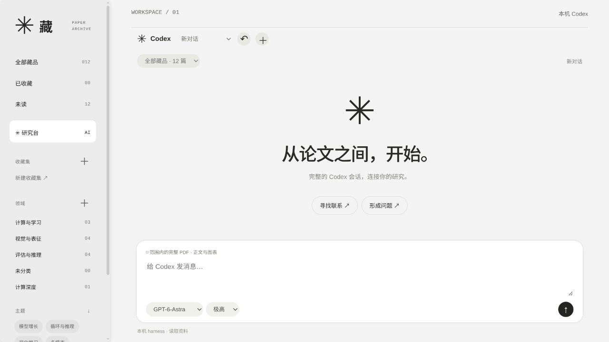

# 藏 · Paper Archive

A quiet desktop library for papers, reading, and research across papers.

灰白、平面、几何。收藏、阅读、批注，把不同论文放在一起讨论。



## What it does

- **Library:** gallery, catalog and matrix views; keyword and semantic search; your own collections and domains.
- **Reader:** continuous PDF pages, selectable text, outlines, search, bilingual switching, saved positions, highlights and notes.
- **Codex conversations:** real, persistent local Codex threads in the reader and research workspace. Choose the model and reasoning effort from your installed harness, see streamed answers and tool activity, stop a turn, and continue after restarting the app.
- **Complete PDF access:** Codex can read any page and view original page images, including figures and equations. Research conversations can browse the whole library or a selected collection. Page citations open the bilingual reader; formulas render locally.
- **arXiv ingestion:** original PDF + LaTeX source → Chinese translation → XeLaTeX compilation → four reading notes → classification. Progress is retained for retries. Existing papers are deduplicated by arXiv ID.
- **Your AI:** your local Codex login and configuration, or your own API key. API mode retains the simpler structured question/answer workflow. Import and search use separate structured jobs.

## Run the desktop app

Requires Python 3.11+ and Node.js 22+ for development. Packaged builds bundle Python and the reader dependencies.

```sh
git clone https://github.com/kevin258258/paper-archive.git
cd paper-archive
python3 -m venv .venv
. .venv/bin/activate
pip install -r requirements.txt
npm ci
npm start
```

On Windows, activate `.venv\Scripts\activate` and set `PAPER_PYTHON` to that environment's `python.exe` before `npm start`. On first launch, choose a paper directory. An empty directory works; the app creates its structure as needed.

**AI setup:** install and log in to [Codex CLI](https://developers.openai.com/codex/cli/), or open Settings and provide your API base URL, protocol, model and key. API endpoints must support JSON Schema structured output. Remote endpoints require HTTPS; local model servers may use loopback HTTP.

**Codex harness:** tested with Codex CLI 0.162.1. The app launches your `codex app-server` over stdio and uses its native `thread/start`, `thread/resume`, `turn/start` and streaming notifications. Settings can point to another local Codex executable. Model choices and supported reasoning efforts come from the harness; new conversations inherit your local defaults. No tools are disabled and no low-effort or short-answer instruction is imposed on conversations. Threads start with a read-only sandbox; commands or file changes requiring approval appear in the app. The standard Codex login, skills and MCP configuration remain yours.

Each conversation shows its native thread ID. Once a turn has been submitted, it can also be continued with `codex resume <thread-id>`. Avoid using two clients on the same thread simultaneously. The app retains its own display history; turns added by another client are part of Codex's model context but are not currently imported into the app's display history. The ↶ control opens pre-0.2 question/answer records.

**Full translation:** install XeLaTeX with `ctex`, Fandol fonts and the LaTeX packages required by the paper. TeX Live and MiKTeX can provide these. Some arXiv papers have no usable LaTeX source or need manual compilation repair; failed work remains incomplete and resumable, never silently reported as translated. The retained compilation log helps diagnose missing packages. The portable skill also calls for visual review of the finished PDF; automated compilation alone does not guarantee publication-quality layout.

## Data and privacy

The program and your library are separate. There is no hosted account or built-in telemetry.

```text
<your-vault>/
  10-领域/<stable-domain-folder>/<paper>/
    00-论文卡片.md
    metadata.json
    original.pdf / 中文版.pdf
    tex_source/ / tex_cn/
    Agent-*.md
  90-待整理/                  # resumable imports
  .paper-archive/
    taxonomy.json            # editable domains and manual assignments
    state/                   # local SQLite, thumbnails, preferences, job results
```

Paper contents and queries are sent to the AI provider you choose when you invoke an AI feature. Personal drafts and annotations are not automatically added to cross-paper prompts. The full Codex harness can use your configured local tools and access files permitted by its sandbox. Native threads also persist in your own Codex home directory. Back up that directory if you need to move resumable Codex conversations to another machine.

PDF access is tool based: the complete files are available, with text reads and page images retrieved as needed. This is not a ChatGPT PDF-upload API or a claim that every page is always in the model context. Native Codex citations are navigable but are not automatically quote-verified. The older API mode still verifies literal quotations; neither mode guarantees the correctness of an interpretation.

API keys are stored in the operating system's encrypted key store through Electron when available. If secure storage is unavailable, a newly entered key is used only for the current run. The key is never returned by the HTTP settings endpoint. For CLI/development usage, supply `PAPER_API_KEY` or `OPENAI_API_KEY` in your own environment. No account, login session, key, paper library or personal note is included in this repository.

The desktop starts its own loopback backend on an ephemeral port, protected by a per-launch capability. No public listener is created. The browser development server is loopback-only, with host, origin and mutation-token checks.

Existing local-reader collections, annotations and conversations are copied using SQLite backup on the first desktop launch when the earlier reader's state is found in the selected vault. Originals are left intact. Back up the entire vault and the desktop application data when moving to another machine; API keys should be configured again there.

## Domains and automation

Add a domain, describe its scope, then assign papers through their detail view. New automatic classifications consult the current `.paper-archive/taxonomy.json`. Human assignments take precedence. Reassigning an existing paper is virtual, preserving its physical path and Obsidian links. Renaming a domain keeps its stable ID and folder.

The portable [arxiv-translate skill](skills/arxiv-translate/SKILL.md) contains no personal paths or credentials. It can be installed in your own skills directory; set `PAPER_ARCHIVE_HOME` to this checkout and `PAPER_VAULT_ROOT` to your library for external automation. The app does not require a global skill installation.

```sh
python scripts/archive.py --vault /path/to/your/library domains
python scripts/archive.py --vault /path/to/your/library import 2406.02469
python scripts/archive.py --vault /path/to/your/library validate
```

The packaged backend also accepts `paper-backend --cli --vault <path> …`. CLI API calls need your environment key; they cannot silently extract the desktop's encrypted key.

## Development and builds

```sh
python scripts/test.py
python scripts/build_backend.py
npm run dist:linux
```

Linux builds produce an AppImage and a tar archive; the latter works without FUSE. macOS and Windows build targets are configured but have not been validated on those systems. Build on the target OS. Initial binaries are unsigned.

A synthetic demo can be generated without downloading papers:

```sh
python scripts/demo.py --output /tmp/paper-archive-demo
PAPER_VAULT_ROOT=/tmp/paper-archive-demo npm start
```

The optional browser development server is `python server.py`; environment variables `PAPER_VAULT_ROOT`, `PAPER_READER_STATE`, `PAPER_READER_PORT` and `PAPER_PYTHON` override local paths/runtime. API and Codex diagnostics remain local. Never commit a real vault, state directory, `.env`, login directory or diagnostic log.

See [architecture and validation](docs/DEVELOPMENT.md) for limits, interfaces and checks. Contributions are welcome through issues and pull requests.

## License

[AGPL-3.0-only](LICENSE). PDF extraction uses PyMuPDF under AGPL; third-party packages retain their own licenses. See [third-party notices](THIRD_PARTY_NOTICES.md). This project is independent of OpenAI and arXiv.
